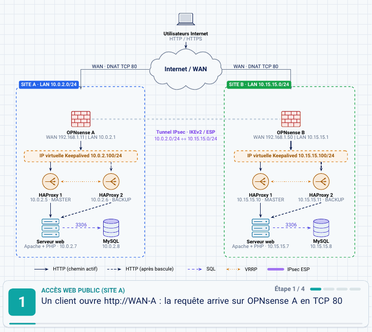

# 🔐 HAGate

**Deux sites d'entreprise reliés par un tunnel IPsec chiffré, chacun publiant une application web hautement disponible derrière un pare-feu OPNsense.**

     

Au départ : deux sites, chacun avec un pare-feu OPNsense et quatre VM Ubuntu. À l'arrivée : un **site web public derrière une IP virtuelle Keepalived**, une **politique de pare-feu au strict nécessaire**, et un **tunnel IKEv2/ESP** qui permet aux deux LAN de communiquer sans NAT. Tout tourne sur un portable avec VirtualBox, Vagrant et Ansible.

[English](README.md) · **Français**

| Site | Étudiant | LAN | Dossier |
|---|---|---|---|
| A | Ahmed Chakcha | `10.0.2.0/24` | [`site-a/`](site-a/) |
| B | Mohamed Ali Djemal | `10.15.15.0/24` | [`site-b/`](site-b/) |

**État :** les sites A et B sont construits et testés (parties 1 à 5). Le tunnel IPsec (partie 6) se configure en binôme.

## Sommaire

1. [Architecture](#1-architecture)
2. [Organisation du dépôt](#2-organisation-du-dépôt)
3. [Prérequis](#3-prérequis)
4. [Créer les VM](#4-créer-les-vm)
5. [Installer OPNsense](#5-installer-opnsense)
6. [Configurer les VM avec Ansible](#6-configurer-les-vm-avec-ansible)
7. [Tests dans le LAN](#7-tests-dans-le-lan)
8. [Publier le site (redirection de ports)](#8-publier-le-site-redirection-de-ports)
9. [Tunnel IPsec entre les sites](#9-tunnel-ipsec-entre-les-sites)
10. [Tests de recette](#10-tests-de-recette)
11. [Dépannage](#11-dépannage)
12. [Glossaire](#12-glossaire)

---

## 1. Architecture

<p align="center">
  
</p>

L'animation se déroule en quatre parties :

1. **Accès web public** : un client atteint le site A par le DNAT, la VIP, HAProxy, Apache et MySQL.
2. **Création du tunnel IPsec** : IKE_SA_INIT, puis IKE_AUTH, puis la Child SA. Le lien passe de rien, à l'IKE SA, au tunnel ESP.
3. **Haute disponibilité** : le HAProxy MASTER tombe et la VIP passe sur HAProxy 2.
4. **Le site B pingue le site A** : echo request et echo reply à travers le tunnel, avec la source et la destination de chaque paquet.

**Flux web :** client → WAN OPNsense (DNAT 80/443) → VIP → HAProxy actif → Apache → MySQL.
**Flux inter-sites :** `10.0.2.0/24` ↔ tunnel IPsec ↔ `10.15.15.0/24`, sans NAT entre les deux LAN.

### Plan d'adressage

| Machine | Rôle | Site A | Site B |
|---|---|---|---|
| OPNsense WAN (`em0`) | NAT, redirection de ports, extrémité IPsec | `192.168.1.11` (fixe) | `192.168.1.50` (fixe) |
| OPNsense LAN (`em1`) | Passerelle par défaut des VM | `10.0.2.1` | `10.15.15.1` |
| VIP | Portée par le HAProxy actif | `10.0.2.100` | `10.15.15.100` |
| `haproxy-master` | Keepalived MASTER | `10.0.2.5` (prio 110) | `10.15.15.10` (prio 150) |
| `haproxy-backup` | Keepalived BACKUP | `10.0.2.6` (prio 100) | `10.15.15.11` (prio 100) |
| `web` | Apache + PHP | `10.0.2.7` | `10.15.15.7` |
| `mysql` | Base `appdb`, utilisateur `app` | `10.0.2.8` | `10.15.15.8` |
| VRRP | `virtual_router_id` / poids du suivi | `51` / `-20` | `52` / `-60` |

Chaque VM a deux cartes : `enp0s3` (NAT VirtualBox, déplacé en `192.168.250.0/24`, utilisé seulement par Vagrant pour SSH) et `enp0s8` (réseau interne `siteA-lan` / `siteB-lan`, le LAN du projet).

---

## 2. Organisation du dépôt

```
HAGate/
├── README.md / README.fr.md     ce guide (EN / FR)
├── docs/                        architecture animée (architecture_en.gif / _fr.gif)
├── report/                      le rapport (rapport.pdf)
├── site-a/                      Site A : Vagrantfile + Ansible
│   ├── Vagrantfile              4 VM, carte NAT sortie de 10.0.2.0/24
│   ├── configs/                 livrables : keepalived.conf, haproxy.cfg
│   └── ansible/
│       ├── group_vars/all.yml   le seul fichier qui change entre les sites
│       ├── network.yml          route par défaut via OPNsense
│       ├── site.yml             rôles : mysql, web, haproxy, keepalived
│       └── roles/
└── site-b/                      Site B : mêmes rôles, valeurs du site B (voir site-b/README.md)
```

---

## 3. Prérequis

VirtualBox 7.x, Vagrant 2.4+, Ansible 2.14+, ISO OPNsense `dvd` amd64 (26.7).

```bash
ansible-galaxy collection install community.mysql
vagrant --version && VBoxManage --version && ansible --version
```

---

## 4. Créer les VM

Depuis `site-a/` (site B : voir [`site-b/README.md`](site-b/README.md)) :

```bash
vagrant validate
vagrant up --no-provision
vagrant status

for vm in sitea-mysql sitea-web sitea-haproxy-backup sitea-haproxy-master; do
  echo "== $vm"; vagrant ssh $vm -c "ip -br a"
done
vagrant ssh sitea-web -c "ping -c2 10.0.2.8"
```

> Le NAT VirtualBox utilise `10.0.2.0/24` par défaut, le même sous-réseau que le site A. Le `Vagrantfile` le déplace avec `--natnet1 192.168.250.0/24`.

---

## 5. Installer OPNsense

| Paramètre | Valeur |
|---|---|
| Nom / OS | `sitea-opnsense` / BSD, FreeBSD (64 bits) |
| RAM / CPU / disque | 2048 Mo / 2 / 15 Go |
| Carte 1 (WAN) | Accès par pont, Intel PRO/1000 MT Desktop, promiscuité *Allow All* |
| Carte 2 (LAN) | Réseau interne nommé exactement `siteA-lan`, promiscuité *Allow All* |

Console :
1. Option **1** : pas de LAGG ni de VLAN, WAN = `em0`, LAN = `em1` (comparer les adresses MAC).
2. Option **2**, LAN : `10.0.2.1/24`, sans passerelle, sans serveur DHCP.
3. WAN : adresse fixe (statique, ou réservation DHCP sur la box). C'est l'identité du pare-feu pour IPsec.
4. Option **7** : ping de la box et de `1.1.1.1`.

Puis dans la GUI, **Interfaces → WAN** : décocher *Block private networks* et *Block bogon networks* (l'« Internet » du labo est `192.168.1.0/24`).

La GUI n'est accessible que depuis le LAN. On l'ouvre par un tunnel SSH :

```bash
vagrant ssh sitea-web -- -L 8443:10.0.2.1:443     # puis https://127.0.0.1:8443
vagrant ssh sitea-web -- -L 8444:10.0.2.1:22      # ssh -p 8444 root@127.0.0.1
```

> Retirer l'ISO après l'installation (Configuration → Stockage), sinon la VM redémarre sur l'installateur. Après une réinstallation : `ssh-keygen -R 10.0.2.1`.

---

## 6. Configurer les VM avec Ansible

Depuis `site-a/`, OPNsense démarré :

```bash
ansible-playbook ansible/network.yml               # 1. route par défaut via OPNsense
ansible-playbook ansible/site.yml                  # 2. mysql, web, haproxy, keepalived
ansible-playbook ansible/site.yml --tags mysql     # un seul rôle
```

| Règle | Pourquoi |
|---|---|
| Lancer `network.yml` en premier | `apt` a besoin d'Internet via OPNsense |
| Relancer `network.yml` après `vagrant reload` | la route NAT de Vagrant revient |
| HAProxy avant Keepalived | le script de santé de Keepalived surveille HAProxy |
| Le fichier MySQL s'appelle `zz-lan.cnf` | il doit être lu après le `mysqld.cnf` d'Ubuntu |
| priorité + poids < priorité du BACKUP | sinon un HAProxy arrêté garde la VIP (A : 110-20, B : 150-60) |
| Même `vrid` et même `vrrp_pass` sur les deux nœuds | sinon les deux nœuds prennent la VIP |

Vérifications :

```bash
vagrant ssh sitea-web -c "ip route get 1.1.1.1"                  # via 10.0.2.1
vagrant ssh sitea-mysql -c "sudo ss -tlnp | grep 3306"           # 10.0.2.8:3306
vagrant ssh sitea-web -c "nc -zv -w3 10.0.2.8 3306"              # succeeded
vagrant ssh sitea-web -c "curl -s http://localhost | grep -c 'Sarah Ben Ali'"   # 1
```

---

## 7. Tests dans le LAN

```bash
# VIP uniquement sur le master
vagrant ssh sitea-haproxy-master -c "ip a show enp0s8 | grep 10.0.2.100"   # présente
vagrant ssh sitea-haproxy-backup -c "ip a show enp0s8 | grep 10.0.2.100"   # rien
vagrant ssh sitea-web -c "curl -sI -m 5 http://10.0.2.100 | head -1"       # 200 OK

# Bascule (Keepalived arrêté)
vagrant ssh sitea-haproxy-master -c "sudo systemctl stop keepalived"
sleep 5
vagrant ssh sitea-haproxy-backup -c "ip a show enp0s8 | grep 10.0.2.100"   # la VIP est ici
vagrant ssh sitea-web -c "curl -sI -m 5 http://10.0.2.100 | head -1"       # toujours 200
vagrant ssh sitea-haproxy-master -c "sudo systemctl start keepalived"

# Bascule (panne de HAProxy, teste le script de suivi)
vagrant ssh sitea-haproxy-master -c "sudo systemctl stop haproxy"
sleep 6
vagrant ssh sitea-haproxy-backup -c "ip a show enp0s8 | grep 10.0.2.100"
vagrant ssh sitea-haproxy-master -c "sudo systemctl start haproxy"
```

---

## 8. Publier le site (redirection de ports)

**Firewall → NAT → Destination NAT → Add**

| Champ | Valeur |
|---|---|
| Interface / version / protocole | WAN / IPv4 / TCP |
| Destination / port | WAN address / HTTP (80), et une seconde règle pour 443 |
| IP / port de redirection | `10.0.2.100` (VIP) / HTTP (80) |
| Association de règle de filtrage | *Add associated filter rule* |

Le NAT est appliqué avant le filtrage : la règle d'autorisation du WAN doit viser la VIP (`10.0.2.100:80`), pas l'adresse WAN.

```bash
curl -I -m 5 http://192.168.1.11                         # 200 OK
nc -zv -w3 192.168.1.11 3306                             # doit expirer (isolation)
while true; do curl -s -o /dev/null -m 2 -w "%{http_code}\n" http://192.168.1.11; sleep 1; done
```

Sauvegarder **System → Configuration → Backups → Download** (ne pas le committer : il contient les hachages de mots de passe et la PSK).

---

## 9. Tunnel IPsec entre les sites

Remplir ce tableau ensemble, puis configurer **VPN → IPsec → Connections** sur les deux pare-feux avec les valeurs en miroir.

| Phase | Paramètre | OPNsense A | OPNsense B |
|---|---|---|---|
| 1 | Version IKE / authentification | IKEv2 / PSK | IKEv2 / PSK |
| 1 | Propositions | `aes256-sha256-modp2048` | identique |
| 1 | Durée de vie / DPD | 28800 s / 30 s | identique |
| 1 | Adresse locale / distante | `192.168.1.11` / WAN B | WAN B / `192.168.1.11` |
| 2 | Réseau local / distant | `10.0.2.0/24` / `10.15.15.0/24` | `10.15.15.0/24` / `10.0.2.0/24` |
| 2 | Proposition ESP / PFS | `aes256gcm16-modp2048` / groupe 14 | identique |
| 2 | Durée de vie | 3600 s | identique |

Règles de pare-feu :
- **WAN** : autoriser UDP 500, UDP 4500 et ESP depuis l'adresse WAN du pair uniquement.
- **IPsec** : autoriser ICMP et TCP 80/443 du LAN distant vers le LAN local.

La PSK est convenue entre les deux étudiants et n'est pas stockée dans ce dépôt. Les deux WAN doivent pouvoir se joindre.

---

## 10. Tests de recette

| n° | Test | Commande | Attendu |
|---|---|---|---|
| 1 | Web public | `curl -I http://<IP WAN>` | HTTP 200 |
| 2 | Haute disponibilité | `systemctl stop keepalived` sur le MASTER | VIP sur le BACKUP, site toujours accessible |
| 3 | Base de données | `mysql -h 10.0.2.8 -u app -p` depuis `10.0.2.7` | connexion acceptée |
| 4 | Isolation | `nc -zv -w3 <IP WAN> 3306` | expiration |
| 5 | IPsec | VPN → IPsec → Status Overview | phases 1 et 2 établies |
| 6 | Inter-sites | `ping 10.15.15.7` depuis `10.0.2.7` | réponses, source toujours `10.0.2.7` |

---

## 11. Dépannage

Tester de l'intérieur vers l'extérieur : la VIP depuis une VM du LAN, puis la route, puis **Firewall → Log Files → Live View**, puis `tcpdump -ni em0 tcp port 80` sur OPNsense.

| Symptôme | Correction |
|---|---|
| Les VM ne pinguent pas `10.0.2.1` | La carte 2 doit s'appeler exactement `siteA-lan` ; vérifier le sous-réseau NAT |
| `em0` et `em1` inversées | Option 1 de la console, comparer les adresses MAC |
| OPNsense redémarre sur l'installateur | Retirer l'ISO |
| Aucune réponse sur le WAN | Décocher *Block private / bogon networks* |
| Le port 80 expire depuis le PC | La règle doit viser la VIP ; pont sur Ethernet, pas sur Wi-Fi |
| `apt` échoue dans Ansible | Démarrer OPNsense, lancer `network.yml` |
| MySQL sur `127.0.0.1` | `ansible-playbook ansible/site.yml --tags mysql` (fichier `zz-lan.cnf`) |
| HAProxy ne démarre pas sur le BACKUP | `ip_nonlocal_bind=1` ou `bind *:80` |
| Les deux nœuds ont la VIP | Même `vrid` et mot de passe, VRRP unicast, `tcpdump -i enp0s8 vrrp` |
| La VIP reste sur un HAProxy arrêté | priorité + poids doit passer sous le BACKUP |
| Plus d'Internet après `vagrant reload` | Relancer `network.yml` |
| `NO_PROPOSAL_CHOSEN` | Algorithmes ou groupe DH différents |
| `AUTHENTICATION_FAILED` | PSK différente, ou identifiants inversés |
| `TS_UNACCEPTABLE` | Réseaux local/distant non mis en miroir |
| Tunnel monté, ping KO | Règle manquante sur l'interface IPsec |

---

## 12. Glossaire

| Terme | Signification |
|---|---|
| VPN | Tunnel chiffré qui relie des réseaux à travers un réseau non fiable |
| IPsec / IKEv2 / ESP | Suite de chiffrement en couche 3 / échange de clés (UDP 500) / données chiffrées (IP 50) |
| NAT / DNAT / NAT-T | Traduction d'adresses / NAT de destination (redirection de ports) / ESP dans UDP 4500 |
| SA / PSK / PFS | Security Association / clé pré-partagée / nouvelle clé DH à chaque phase 2 |
| VIP / VRRP | IP virtuelle portée par le nœud actif / protocole qui élit ce nœud |
| Keepalived / HAProxy | Service VRRP / reverse proxy avec contrôles de santé |
| DPD | Dead Peer Detection : vérifie que l'autre pare-feu répond |
| pf | Moteur de pare-feu à états d'OPNsense |
