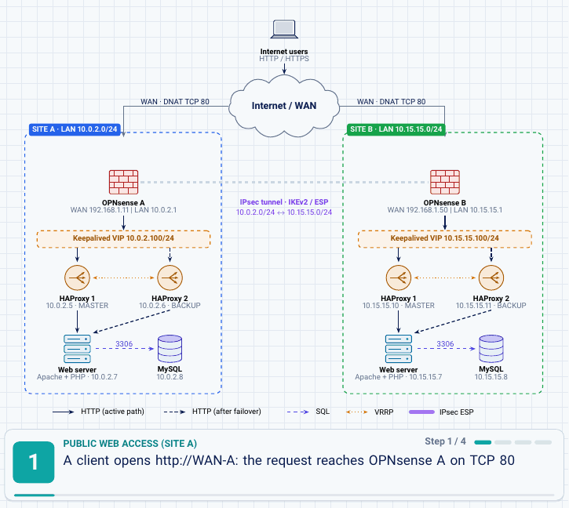

# 🔐 HAGate

**Two company sites joined by an encrypted IPsec tunnel, each one publishing a highly available web app behind an OPNsense firewall.**

     

Two sites go in, each with an OPNsense firewall and four Ubuntu VMs. Out come a **public web site behind a Keepalived virtual IP**, a **least-privilege firewall policy**, and an **IKEv2/ESP tunnel** that lets the two LANs talk to each other without NAT. It all runs on a laptop with VirtualBox, Vagrant and Ansible.

**English** · [Français](README.fr.md)

| Site | Student | LAN | Folder |
|---|---|---|---|
| A | Ahmed Chakcha | `10.0.2.0/24` | [`site-a/`](site-a/) |
| B | Mohamed Ali Djemal | `10.15.15.0/24` | [`site-b/`](site-b/) |

**Status:** Site A and Site B are built and tested (parts 1 to 5). The IPsec tunnel (part 6) is configured together.

## Contents

1. [Architecture](#1-architecture)
2. [Repository layout](#2-repository-layout)
3. [Prerequisites](#3-prerequisites)
4. [Create the VMs](#4-create-the-vms)
5. [Install OPNsense](#5-install-opnsense)
6. [Configure the VMs with Ansible](#6-configure-the-vms-with-ansible)
7. [Tests inside the LAN](#7-tests-inside-the-lan)
8. [Publish the site (port forwarding)](#8-publish-the-site-port-forwarding)
9. [IPsec tunnel between the sites](#9-ipsec-tunnel-between-the-sites)
10. [Acceptance tests](#10-acceptance-tests)
11. [Troubleshooting](#11-troubleshooting)
12. [Glossary](#12-glossary)

---

## 1. Architecture

<p align="center">
  
</p>

The animation runs in four parts:

1. **Public web access**: a client reaches site A through DNAT, the VIP, HAProxy, Apache and MySQL.
2. **Building the IPsec tunnel**: IKE_SA_INIT, then IKE_AUTH, then the Child SA. The link goes from none, to the IKE SA, to the ESP tunnel.
3. **High availability**: the HAProxy MASTER fails and the VIP moves to HAProxy 2.
4. **Site B pings site A**: echo request and echo reply through the tunnel, with the source and destination of each packet.

**Web flow:** client → OPNsense WAN (DNAT 80/443) → VIP → active HAProxy → Apache → MySQL.
**Inter-site flow:** `10.0.2.0/24` ↔ IPsec tunnel ↔ `10.15.15.0/24`, with no NAT between the two LANs.

### Address plan

| Machine | Role | Site A | Site B |
|---|---|---|---|
| OPNsense WAN (`em0`) | NAT, port forwarding, IPsec endpoint | `192.168.1.11` (fixed) | `192.168.1.50` (fixed) |
| OPNsense LAN (`em1`) | Default gateway of the VMs | `10.0.2.1` | `10.15.15.1` |
| VIP | Held by the active HAProxy | `10.0.2.100` | `10.15.15.100` |
| `haproxy-master` | Keepalived MASTER | `10.0.2.5` (prio 110) | `10.15.15.10` (prio 150) |
| `haproxy-backup` | Keepalived BACKUP | `10.0.2.6` (prio 100) | `10.15.15.11` (prio 100) |
| `web` | Apache + PHP | `10.0.2.7` | `10.15.15.7` |
| `mysql` | Database `appdb`, user `app` | `10.0.2.8` | `10.15.15.8` |
| VRRP | `virtual_router_id` / tracking weight | `51` / `-20` | `52` / `-60` |

Each VM has two cards: `enp0s3` (VirtualBox NAT, moved to `192.168.250.0/24`, used only by Vagrant for SSH) and `enp0s8` (internal network `siteA-lan` / `siteB-lan`, the project LAN).

---

## 2. Repository layout

```
HAGate/
├── README.md / README.fr.md     this guide (EN / FR)
├── docs/                        animated architecture (architecture_en.gif / _fr.gif)
├── report/                      the report (rapport.pdf)
├── site-a/                      Site A: Vagrantfile + Ansible
│   ├── Vagrantfile              4 VMs, NAT card moved out of 10.0.2.0/24
│   ├── configs/                 deliverables: keepalived.conf, haproxy.cfg
│   └── ansible/
│       ├── group_vars/all.yml   the only file that differs between sites
│       ├── network.yml          default route via OPNsense
│       ├── site.yml             roles: mysql, web, haproxy, keepalived
│       └── roles/
└── site-b/                      Site B: same roles, Site B values (see site-b/README.md)
```

---

## 3. Prerequisites

VirtualBox 7.x, Vagrant 2.4+, Ansible 2.14+, OPNsense `dvd` amd64 ISO (26.7).

```bash
ansible-galaxy collection install community.mysql
vagrant --version && VBoxManage --version && ansible --version
```

---

## 4. Create the VMs

From `site-a/` (Site B: see [`site-b/README.md`](site-b/README.md)):

```bash
vagrant validate
vagrant up --no-provision
vagrant status

for vm in sitea-mysql sitea-web sitea-haproxy-backup sitea-haproxy-master; do
  echo "== $vm"; vagrant ssh $vm -c "ip -br a"
done
vagrant ssh sitea-web -c "ping -c2 10.0.2.8"
```

> The VirtualBox NAT uses `10.0.2.0/24` by default, the same subnet as Site A. The `Vagrantfile` moves it with `--natnet1 192.168.250.0/24`.

---

## 5. Install OPNsense

| Setting | Value |
|---|---|
| Name / OS | `sitea-opnsense` / BSD, FreeBSD (64-bit) |
| RAM / CPU / disk | 2048 MB / 2 / 15 GB |
| Adapter 1 (WAN) | Bridged, Intel PRO/1000 MT Desktop, promiscuous *Allow All* |
| Adapter 2 (LAN) | Internal network exactly `siteA-lan`, promiscuous *Allow All* |

Console:
1. Option **1**: no LAGG, no VLAN, WAN = `em0`, LAN = `em1` (compare MAC addresses).
2. Option **2**, LAN: `10.0.2.1/24`, no gateway, no DHCP server.
3. WAN: fixed address (static, or DHCP reservation on the router). It is the identity of the firewall for IPsec.
4. Option **7**: ping the router and `1.1.1.1`.

Then in the GUI, **Interfaces → WAN**: untick *Block private networks* and *Block bogon networks* (the lab "Internet" is `192.168.1.0/24`).

The GUI is reachable from the LAN only. Open it through an SSH tunnel:

```bash
vagrant ssh sitea-web -- -L 8443:10.0.2.1:443     # then https://127.0.0.1:8443
vagrant ssh sitea-web -- -L 8444:10.0.2.1:22      # ssh -p 8444 root@127.0.0.1
```

> Remove the ISO after install (Settings → Storage), otherwise the VM boots into the installer again. After a reinstall: `ssh-keygen -R 10.0.2.1`.

---

## 6. Configure the VMs with Ansible

From `site-a/`, with OPNsense running:

```bash
ansible-playbook ansible/network.yml               # 1. default route via OPNsense
ansible-playbook ansible/site.yml                  # 2. mysql, web, haproxy, keepalived
ansible-playbook ansible/site.yml --tags mysql     # one role only
```

| Rule | Why |
|---|---|
| Run `network.yml` first | `apt` needs Internet through OPNsense |
| Rerun `network.yml` after `vagrant reload` | the Vagrant NAT route comes back |
| HAProxy before Keepalived | the Keepalived health script watches HAProxy |
| MySQL file is `zz-lan.cnf` | it must be read after Ubuntu's `mysqld.cnf` |
| priority + weight < BACKUP priority | otherwise a dead HAProxy keeps the VIP (A: 110-20, B: 150-60) |
| Same `vrid` and `vrrp_pass` on both nodes | otherwise both nodes take the VIP |

Checks:

```bash
vagrant ssh sitea-web -c "ip route get 1.1.1.1"                  # via 10.0.2.1
vagrant ssh sitea-mysql -c "sudo ss -tlnp | grep 3306"           # 10.0.2.8:3306
vagrant ssh sitea-web -c "nc -zv -w3 10.0.2.8 3306"              # succeeded
vagrant ssh sitea-web -c "curl -s http://localhost | grep -c 'Sarah Ben Ali'"   # 1
```

---

## 7. Tests inside the LAN

```bash
# VIP only on the master
vagrant ssh sitea-haproxy-master -c "ip a show enp0s8 | grep 10.0.2.100"   # present
vagrant ssh sitea-haproxy-backup -c "ip a show enp0s8 | grep 10.0.2.100"   # nothing
vagrant ssh sitea-web -c "curl -sI -m 5 http://10.0.2.100 | head -1"       # 200 OK

# Failover (Keepalived stopped)
vagrant ssh sitea-haproxy-master -c "sudo systemctl stop keepalived"
sleep 5
vagrant ssh sitea-haproxy-backup -c "ip a show enp0s8 | grep 10.0.2.100"   # VIP here
vagrant ssh sitea-web -c "curl -sI -m 5 http://10.0.2.100 | head -1"       # still 200
vagrant ssh sitea-haproxy-master -c "sudo systemctl start keepalived"

# Failover (HAProxy crash, tests the tracking script)
vagrant ssh sitea-haproxy-master -c "sudo systemctl stop haproxy"
sleep 6
vagrant ssh sitea-haproxy-backup -c "ip a show enp0s8 | grep 10.0.2.100"
vagrant ssh sitea-haproxy-master -c "sudo systemctl start haproxy"
```

---

## 8. Publish the site (port forwarding)

**Firewall → NAT → Destination NAT → Add**

| Field | Value |
|---|---|
| Interface / version / protocol | WAN / IPv4 / TCP |
| Destination / port | WAN address / HTTP (80), and a second rule for 443 |
| Redirect target IP / port | `10.0.2.100` (VIP) / HTTP (80) |
| Filter rule association | *Add associated filter rule* |

NAT is applied before filtering, so the WAN pass rule must target the VIP (`10.0.2.100:80`), not the WAN address.

```bash
curl -I -m 5 http://192.168.1.11                         # 200 OK
nc -zv -w3 192.168.1.11 3306                             # must time out (isolation)
while true; do curl -s -o /dev/null -m 2 -w "%{http_code}\n" http://192.168.1.11; sleep 1; done
```

Save **System → Configuration → Backups → Download** (do not commit it: it holds password hashes and the PSK).

---

## 9. IPsec tunnel between the sites

Fill this table together, then configure **VPN → IPsec → Connections** on both firewalls with mirrored values.

| Phase | Parameter | OPNsense A | OPNsense B |
|---|---|---|---|
| 1 | IKE version / auth | IKEv2 / PSK | IKEv2 / PSK |
| 1 | Proposals | `aes256-sha256-modp2048` | same |
| 1 | Lifetime / DPD | 28800 s / 30 s | same |
| 1 | Local / remote address | `192.168.1.11` / WAN B | WAN B / `192.168.1.11` |
| 2 | Local / remote subnet | `10.0.2.0/24` / `10.15.15.0/24` | `10.15.15.0/24` / `10.0.2.0/24` |
| 2 | ESP proposal / PFS | `aes256gcm16-modp2048` / group 14 | same |
| 2 | Lifetime | 3600 s | same |

Firewall rules:
- **WAN**: pass UDP 500, UDP 4500 and ESP from the peer WAN address only.
- **IPsec**: pass ICMP and TCP 80/443 from the remote LAN to the local LAN.

The PSK is agreed between the two students and is not stored in this repository. Both WANs must reach each other.

---

## 10. Acceptance tests

| # | Test | Command | Expected |
|---|---|---|---|
| 1 | Public web | `curl -I http://<WAN IP>` | HTTP 200 |
| 2 | High availability | `systemctl stop keepalived` on the MASTER | VIP on the BACKUP, site still up |
| 3 | Database | `mysql -h 10.0.2.8 -u app -p` from `10.0.2.7` | login accepted |
| 4 | Isolation | `nc -zv -w3 <WAN IP> 3306` | timeout |
| 5 | IPsec | VPN → IPsec → Status Overview | phase 1 and 2 up |
| 6 | Inter-site | `ping 10.15.15.7` from `10.0.2.7` | replies, source still `10.0.2.7` |

---

## 11. Troubleshooting

Test from the inside out: VIP from a LAN VM, then the route, then **Firewall → Log Files → Live View**, then `tcpdump -ni em0 tcp port 80` on OPNsense.

| Symptom | Fix |
|---|---|
| VMs cannot ping `10.0.2.1` | Adapter 2 must be named exactly `siteA-lan`; check the NAT subnet |
| `em0` and `em1` swapped | Console option 1, compare MAC addresses |
| OPNsense boots into the installer | Remove the ISO |
| No answer on the WAN | Untick *Block private / bogon networks* |
| Port 80 times out from the PC | Pass rule must target the VIP; bridge on Ethernet, not Wi-Fi |
| `apt` fails in Ansible | Start OPNsense, run `network.yml` |
| MySQL on `127.0.0.1` | `ansible-playbook ansible/site.yml --tags mysql` (file `zz-lan.cnf`) |
| HAProxy fails on the BACKUP | `ip_nonlocal_bind=1` or `bind *:80` |
| Both nodes hold the VIP | Same `vrid` and password, unicast VRRP, `tcpdump -i enp0s8 vrrp` |
| VIP stays on a dead HAProxy | priority + weight must be below the BACKUP |
| No Internet after `vagrant reload` | Rerun `network.yml` |
| `NO_PROPOSAL_CHOSEN` | Algorithms or DH group differ |
| `AUTHENTICATION_FAILED` | PSK differs, or IDs swapped |
| `TS_UNACCEPTABLE` | Local/remote subnets not mirrored |
| Tunnel up, ping fails | Missing rule on the IPsec interface |

---

## 12. Glossary

| Term | Meaning |
|---|---|
| VPN | Encrypted tunnel that joins networks across an untrusted one |
| IPsec / IKEv2 / ESP | Layer 3 encryption suite / key exchange (UDP 500) / encrypted data (IP 50) |
| NAT / DNAT / NAT-T | Address translation / destination NAT (port forwarding) / ESP in UDP 4500 |
| SA / PSK / PFS | Security Association / pre-shared key / new DH key per phase 2 |
| VIP / VRRP | Virtual IP held by the active node / protocol that elects that node |
| Keepalived / HAProxy | VRRP daemon / reverse proxy with health checks |
| DPD | Dead Peer Detection: checks that the other firewall is alive |
| pf | Stateful firewall engine of OPNsense |
